# Mermaid gallery

One diagram per Mermaid type, for comparing renderers side by side.

## Flowchart

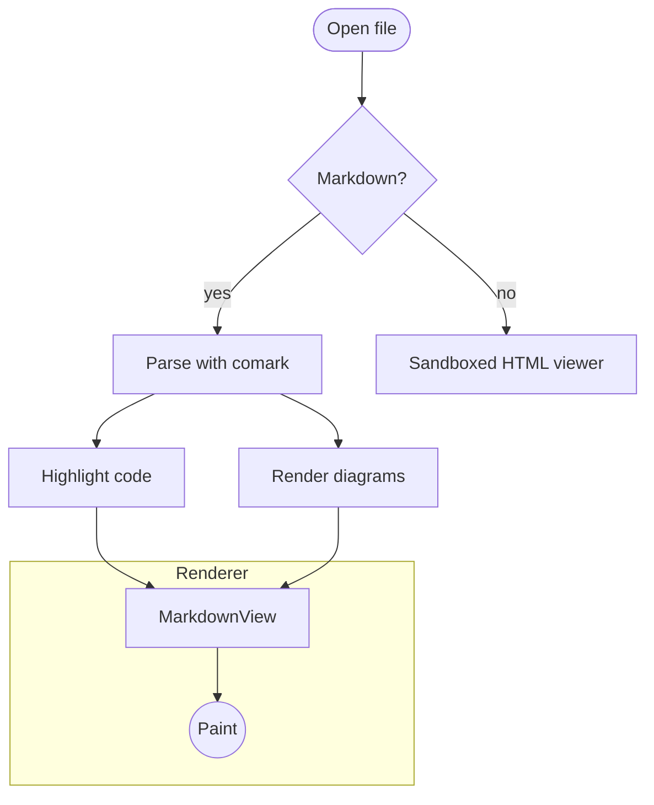

## Sequence

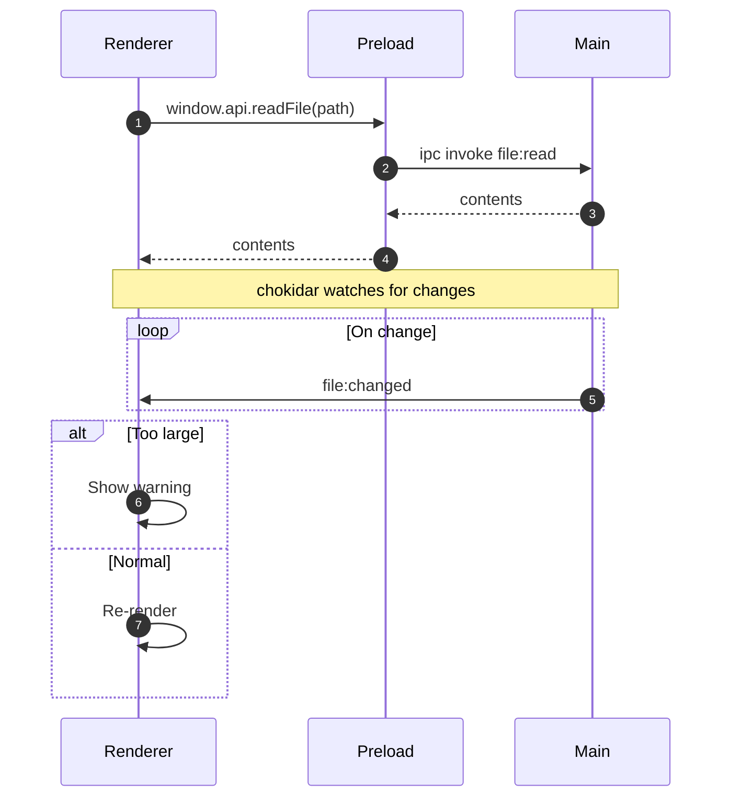

## Class

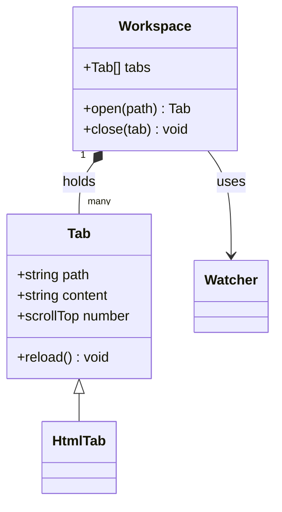

## State

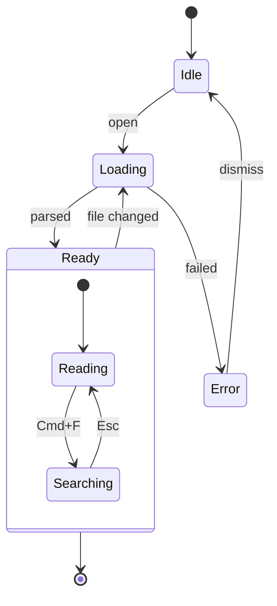

## Entity relationship

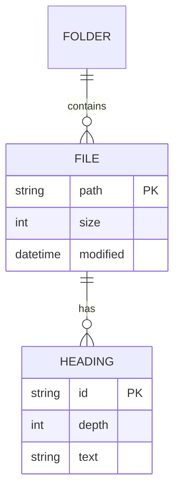

## Gantt

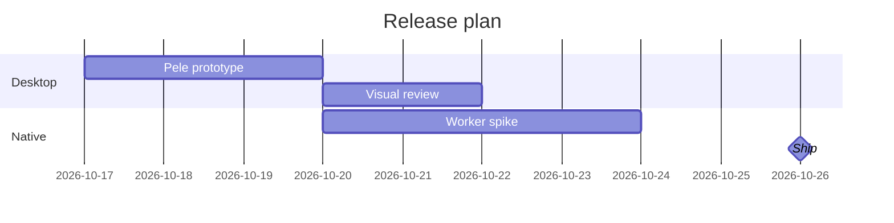

## Pie

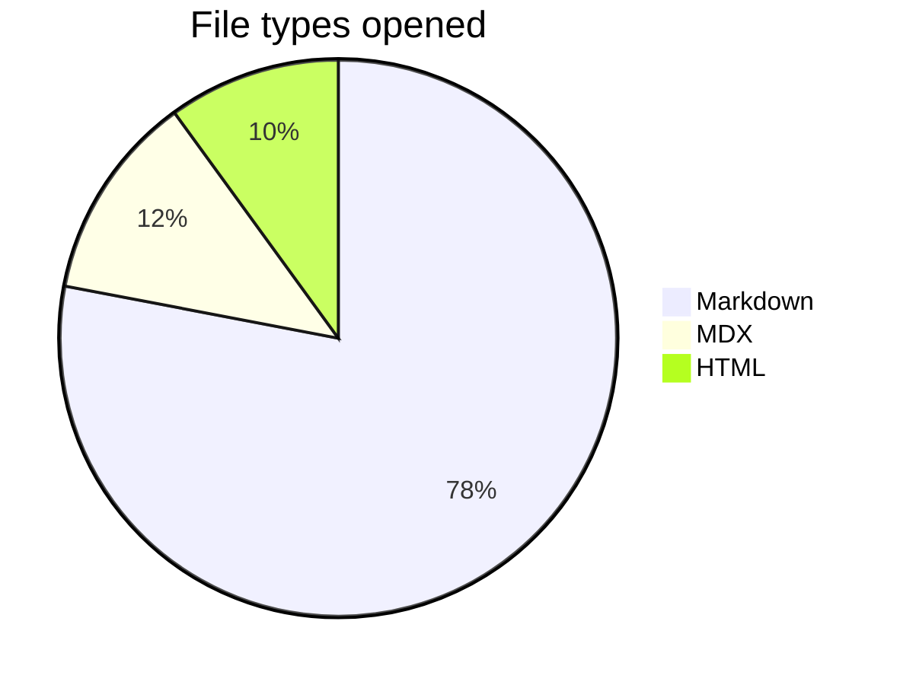

## User journey

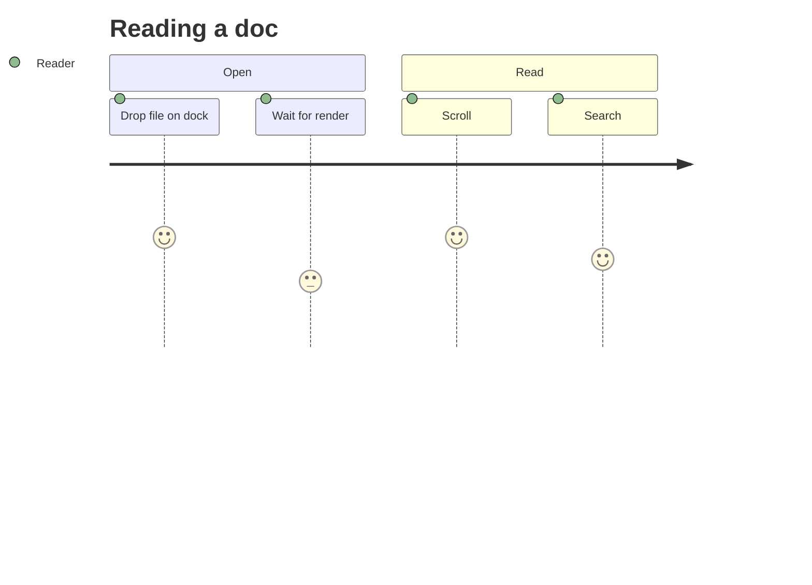

## Git graph

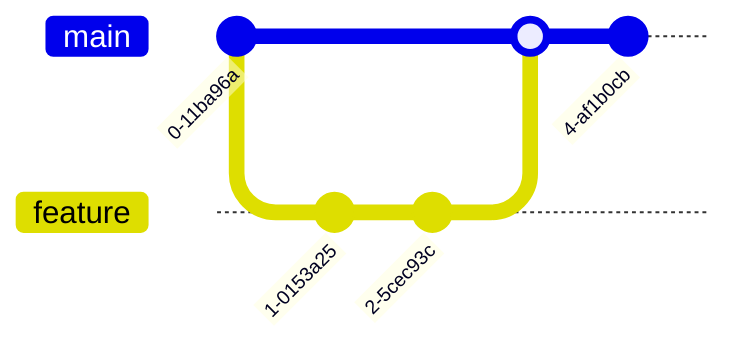

## Mindmap

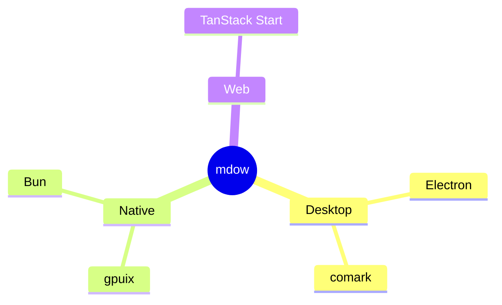

## Timeline

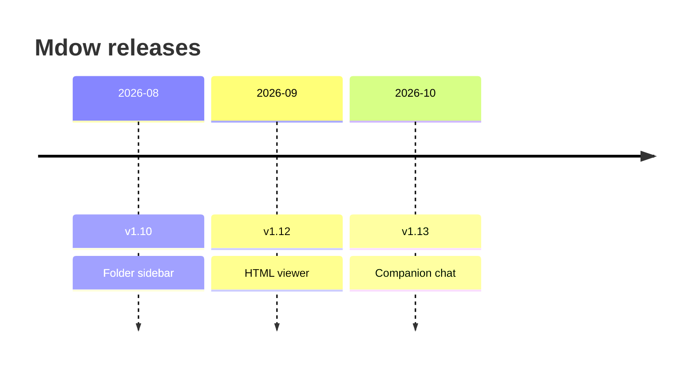

## Quadrant

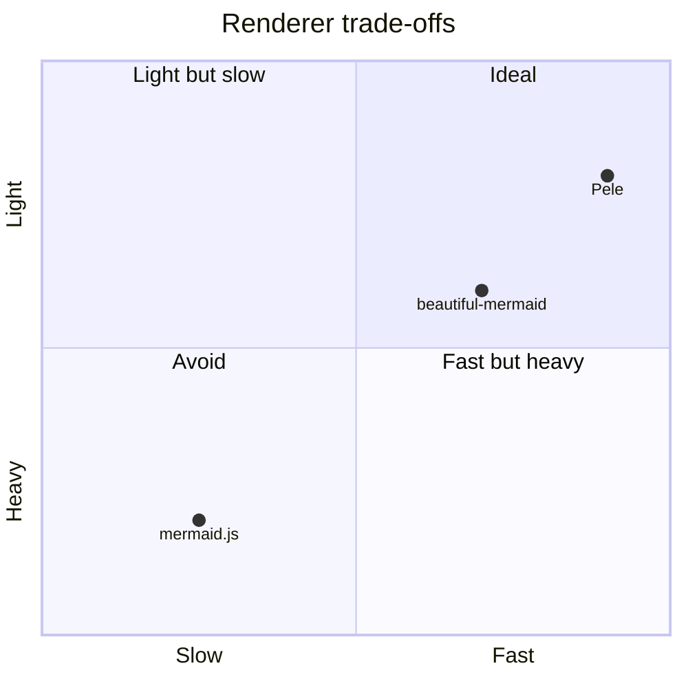

## XY chart

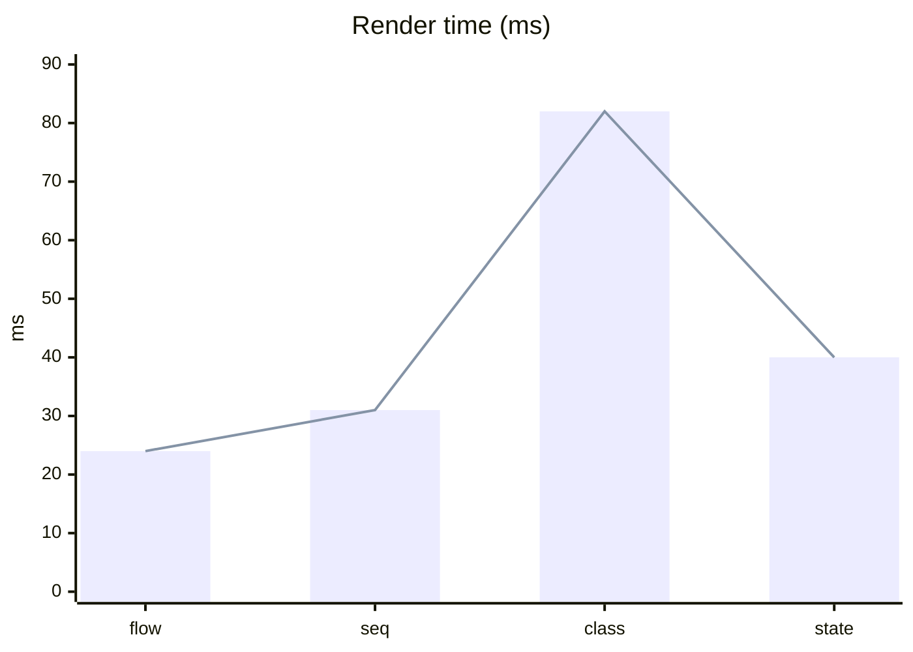

## Sankey

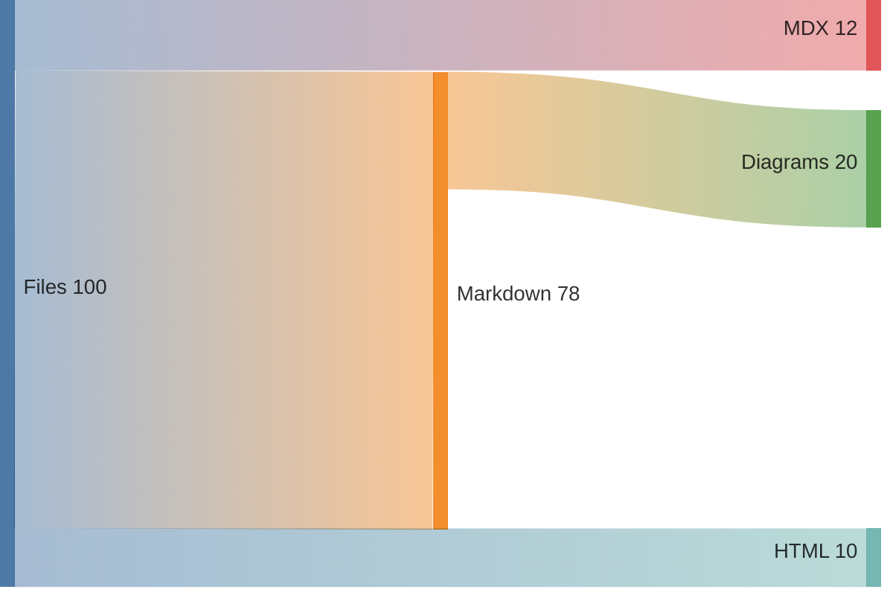

## Block

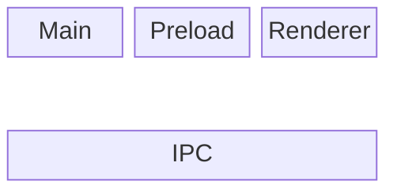

## Broken

```mermaid
flowchart TD
  A -->
  B -->> {oops
```
